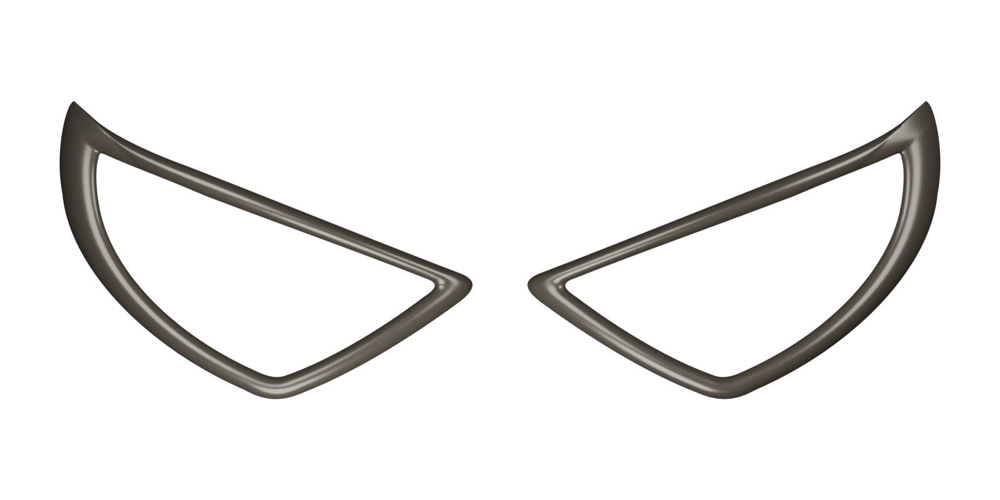

# Lente Miranha — armação vazada para impressão 3D

## Download para impressão

- [Baixar STL da moldura](https://github.com/enzobpagliacci-hub/lenteMiranha/raw/refs/heads/main/modelo/lente.stl)
- [Baixar STL da moldura espelhada](https://github.com/enzobpagliacci-hub/lenteMiranha/raw/refs/heads/main/modelo/lente_espelhada.stl)
- [Baixar pacote completo ZIP](https://github.com/enzobpagliacci-hub/lenteMiranha/raw/refs/heads/main/lente_mascara_v3_90x65_curva10mm.zip)

Envie este repositório ao responsável pela impressão. Importe os STL em **milímetros, escala 100%**. Cada peça mede 90 × 65 mm na vista frontal, com curvatura de 10 mm e profundidade total aproximada de 14 mm. Confira a orientação e os suportes no fatiador.



**Revisão 3 — referência: fotografia da máscara.** O olho mais visível na nova foto foi usado para redesenhar a moldura; a outra peça é espelhada. **O centro permanece vazio:** a peça é apenas a moldura. Não há lente, tela ou membrana no vão.

O contorno tem ponta externa superior elevada, aresta superior descendente, canto junto ao nariz marcado e borda inferior arredondada. A frente agora tem um **perfil elíptico abaulado em toda a faixa**, em vez de uma faixa plana com chanfro. A moldura é mais estreita e acompanha o desenho da referência.

## Arquivos

- `modelo/lente.stl`: peça na mesma orientação da fotografia, pronta para o fatiador; unidades em milímetros.
- `modelo/lente_espelhada.stl`: versão espelhada, caso seja necessário formar um par.
- `modelo/lente_parametrica.scad`: fonte editável no OpenSCAD, com largura, altura, flecha da curvatura, espessura máxima, altura lateral e espelhamento ajustáveis.
- `modelo/lente.blend`: cena de visualização com a malha; escala de unidade configurada para milímetros.
- `modelo/vista_frontal.png`, `modelo/vista_3d.png` e `modelo/vista_curvatura.png`: prévias com fundo transparente; a aparência metálica é apenas ilustrativa.
- `modelo/vista_par.png`: apresentação das duas molduras. A distância de 12 mm entre as caixas das duas peças é ilustrativa; os STL continuam separados, sem ponte ou encaixe entre eles.
- `modelo/validacao.json`: verificação geométrica dos dois STL.

## Dimensões adotadas

As medidas seguem a especificação do usuário: **90 mm de largura × 65 mm de altura**, medidas na projeção frontal. O contorno foi ajustado independentemente em X e Y para alcançar essas duas medidas. O centro continua totalmente aberto.

A moldura inteira, inclusive o verso, acompanha uma **curvatura cilíndrica suave ao longo da largura**, com **flecha de 10 mm**: o centro fica 10 mm à frente do plano que une as extremidades esquerda e direita. O raio correspondente é de **106,25 mm**. Não é uma placa plana. Em coordenadas do modelo, as extremidades traseiras ficam em Z=0 e o centro do verso em Z=10.

A espessura máxima é de **4 mm, medida em Z na crista da borda abaulada**, resultando em **aproximadamente 14 mm de profundidade total**. Junto aos contornos interno e externo, a espessura lateral é de **1,2 mm** e aumenta suavemente até a crista. A espessura perpendicular à superfície varia com a inclinação. A peça não tem encaixes ou furos de fixação.

O contorno foi desenhado manualmente com curvas Bézier. A fotografia da máscara tem perspectiva e não informa a geometria do rosto: esta é uma aproximação visual adaptada às medidas fornecidas, sem garantia de encaixe em uma máscara específica. Verifique as medidas e o encaixe antes de imprimir. O material escuro nas prévias é ilustrativo; o STL contém somente a geometria.

## Impressão inicial sugerida

- A peça é curva: o verso não encosta inteiro na mesa. Como ponto de partida, mantenha a frente para cima e gere suportes sob as regiões elevadas do verso, preferencialmente com interface removível.
- Bico de 0,4 mm, camada de 0,2 mm, 3–4 perímetros e 15–25% de preenchimento.
- PLA é uma opção para protótipo; PETG pode ser usado conforme a aplicação.
- Confirme os suportes, a aderência e a prévia de todas as camadas no fatiador. Pode ser necessário usar brim devido à pequena área de contato das extremidades.
- Para alterar largura, altura ou curvatura, prefira o arquivo paramétrico em vez de escalar o STL: a escala do fatiador também altera a espessura e/ou a flecha.

## Ajustar e gerar novamente

No OpenSCAD, abra `modelo/lente_parametrica.scad`, ajuste os parâmetros no início, pressione **F6** e exporte como STL. O parâmetro `espelhar = true` gera o lado oposto. `flecha_mm = 10` define a curvatura atual; `flecha_mm = 0` gera uma versão plana. `altura_lateral_mm` define a altura das laterais e deve estar entre zero e `espessura_mm`. `secoes_perfil` deve ser par e no mínimo 12; o padrão 24 aproxima a seção elíptica com uma transição suave.

Alternativamente, a partir da raiz do repositório, com Python 3 (sem pacotes externos):

```sh
python3 tools/gerar_modelo.py --largura 90 --altura 65 --flecha 10 --espessura 4 --borda 1.2 --secoes 24
```

Esse comando sobrescreve os dois STL, a fonte SCAD e os dados de dimensões/contornos. Para atualizar a validação e as prévias com Blender 4.3:

```sh
blender --background --threads 4 --python-exit-code 1 --python tools/validar_renderizar.py
```

O validador exige malha fechada, uma única peça, orientação positiva, ausência de faces degeneradas e de interseções entre triângulos sem vértices em comum. Também verifica o vão aberto, a moldura presente, as dimensões totais, a flecha de 10 mm por interseção de raios e a espessura máxima de 4 mm na crista. Isso verifica a geometria; não substitui o teste físico de encaixe ou resistência.
